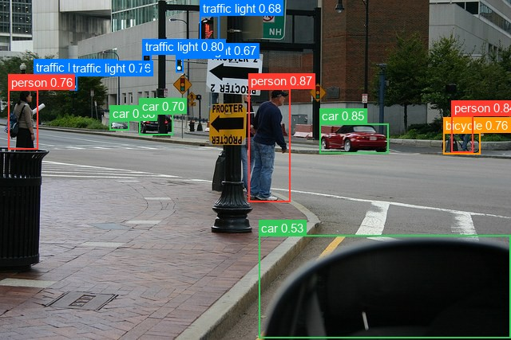
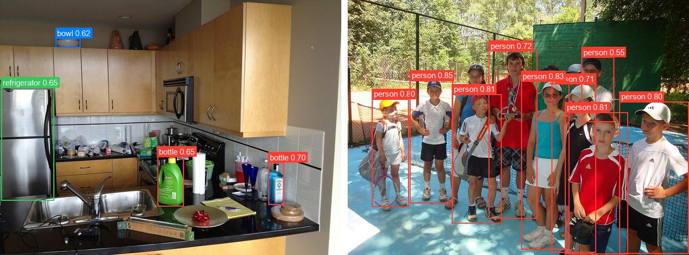

# Conditional DETR

<div class="kf-note kf-note--weights">
<b>Weights:</b> pretrained Keras weights live on Hugging Face under
<a href="https://huggingface.co/zeromodels">zeromodels/&lt;variant&gt;</a>
(each repo carries <code>zm_config.json</code> + <code>model.weights.h5</code>).
Load with <code>from_weights("zeromodels/&lt;variant&gt;")</code>.
</div>

Conditional DETR keeps DETR's recipe (a ResNet backbone, a transformer encoder over the stride-32 feature map, learned object queries, set prediction) but changes how the decoder's cross-attention finds objects. DETR's queries have to learn content and location in one embedding, which is why it needs around 500 training epochs.

Conditional DETR splits them. Each query predicts a 2D reference point, and its cross-attention query becomes the concatenation of a content part and a *spatial* part: the sine embedding of that point, scaled by a transformation computed from the decoder content. Keys are split the same way, so every head attends to a band around the object (an extremity, or the inside of the box). Boxes are then predicted as offsets from the reference point. The result trains 6.7x to 10x faster than DETR for the same accuracy.

**Paper**: [Conditional DETR for Fast Training Convergence](https://arxiv.org/abs/2108.06152)

## API

### ConditionalDETRDetect

```python
ConditionalDETRDetect(
    backbone_variant="ResNet50",
    hidden_dim=256,
    num_heads=8,
    num_encoder_layers=6,
    num_decoder_layers=6,
    dim_feedforward=2048,
    dropout_rate=0.1,
    num_queries=300,
    num_classes=91,
    image_size=None,
    input_tensor=None,
    name="ConditionalDETRDetect",
)
```

The detection model: backbone, transformer, and the class and box heads. **This is the
class for object detection.**

**Parameters**

- **backbone_variant** (`str`, *optional*, defaults to `"ResNet50"`): CNN backbone, `"ResNet50"` or `"ResNet101"`.
- **hidden_dim** (`int`, *optional*, defaults to `256`): transformer width, the `d_model` of the HF config.
- **num_heads** (`int`, *optional*, defaults to `8`): attention heads.
- **num_encoder_layers** (`int`, *optional*, defaults to `6`): encoder depth.
- **num_decoder_layers** (`int`, *optional*, defaults to `6`): decoder depth.
- **dim_feedforward** (`int`, *optional*, defaults to `2048`): FFN inner dimension.
- **dropout_rate** (`float`, *optional*, defaults to `0.1`): dropout, active only during training.
- **num_queries** (`int`, *optional*, defaults to `300`): learned object queries, the hard ceiling on detections per image.
- **num_classes** (`int`, *optional*, defaults to `91`): COCO's 91 classes. Scores are per-class sigmoids, so there is no "no object" class.
- **image_size** (`int` or `tuple`, *optional*, defaults to `None`): `None` builds a dynamic input that takes the processor's aspect-preserving resize. An int or `(H, W)` fixes the input size.
- **input_tensor** (*optional*): pre-existing input tensor to build on.
- **name** (`str`, *optional*, defaults to `"ConditionalDETRDetect"`): model name.

**Call** `model(pixel_values, training=False)`. **Returns** a `dict`:

- **logits** (`(B, num_queries, num_classes)`): per-query class logits (apply a sigmoid for scores).
- **pred_boxes** (`(B, num_queries, 4)`): normalized `(cx, cy, w, h)` in `[0, 1]`.
- **last_hidden_state** (`(B, num_queries, hidden_dim)`): decoder output.

Raw output is one prediction per query, most of them low-scoring. Run it through
`post_process_object_detection` to get scored, pixel-space boxes.

### ConditionalDetrModel

```python
ConditionalDetrModel(
    backbone_variant="ResNet50",
    hidden_dim=256,
    num_heads=8,
    num_encoder_layers=6,
    num_decoder_layers=6,
    dim_feedforward=2048,
    dropout_rate=0.1,
    num_queries=300,
    image_size=None,
    input_tensor=None,
    name="ConditionalDetrModel",
)
```

The backbone and transformer without detection heads, ending at the decoder hidden
states. Use it when you want Conditional DETR features to attach your own head to. It
loads from the same repos as the detector.

**Parameters** are identical to [ConditionalDETRDetect](#conditionaldetrdetect), minus
**num_classes**, and **name** defaults to `"ConditionalDetrModel"`.

**Returns** a `dict`:

- **last_hidden_state** (`(B, num_queries, hidden_dim)`): the decoder's last hidden state.
- **reference_points** (`(B, num_queries, 2)`): the per-query `(x, y)` reference point, normalized to `[0, 1]`.

## Preprocessing

### ConditionalDETRImageProcessor

```python
ConditionalDETRImageProcessor(
    size=None,
    resample="bilinear",
    do_rescale=True,
    rescale_factor=1 / 255,
    do_normalize=True,
    image_mean=None,
    image_std=None,
    return_tensor=True,
    data_format=None,
)
```

Resizes keeping the aspect ratio, rescales to `[0, 1]`, and normalizes with ImageNet
statistics.

**Parameters**

- **size** (`dict`, *optional*, defaults to `{"shortest_edge": 800, "longest_edge": 1333}`): the short side is resized to `shortest_edge` unless that pushes the long side past `longest_edge`. A `{"height": H, "width": W}` dict resizes to exactly that size instead.
- **resample** (`str`, *optional*, defaults to `"bilinear"`): resize interpolation.
- **do_rescale** (`bool`, *optional*, defaults to `True`): scale pixels to `[0, 1]`.
- **rescale_factor** (`float`, *optional*, defaults to `1/255`): the rescaling factor.
- **do_normalize** (`bool`, *optional*, defaults to `True`): apply mean/std normalization.
- **image_mean** (`tuple`, *optional*, defaults to `(0.485, 0.456, 0.406)`): per-channel mean.
- **image_std** (`tuple`, *optional*, defaults to `(0.229, 0.224, 0.225)`): per-channel std.
- **return_tensor** (`bool`, *optional*, defaults to `True`): return backend tensors rather than numpy.
- **data_format** (`str`, *optional*): `"channels_last"` or `"channels_first"`. Defaults to `keras.config.image_data_format()`.

**Call** `processor(image)` with a path, a PIL image, an array, or a **list** of any
mix of those. **Returns** a `dict`:

- **pixel_values** (`(B, H, W, 3)`): the preprocessed images, in the configured data format.

A list is preprocessed and zero-padded to the largest image in the batch. See
[Batch Processing](#batch-processing-multiple-images).

**post_process_object_detection**

```python
processor.post_process_object_detection(
    outputs, threshold=0.5, target_sizes=None, label_names=None, top_k=100
)
```

Applies a sigmoid to the logits, takes the `top_k` highest scores over every
(query, class) pair, keeps those that clear `threshold`, and converts their boxes to
pixel-space `(x0, y0, x1, y1)` scaled to `target_sizes`.

- **outputs**: the `dict` returned by the model.
- **threshold** (`float`, *optional*, defaults to `0.5`): minimum class score.
- **target_sizes** (`list` of `(height, width)`, *optional*): original image sizes, one per batch element.
- **label_names** (`list` of `str`, *optional*): class names. Defaults to COCO's 91 classes.
- **top_k** (`int`, *optional*, defaults to `100`): candidates kept before thresholding.

**Returns** a list with one `dict` per image:

- **scores**: sigmoid score per kept detection.
- **labels**: integer class indices.
- **label_names**: the resolved class names.
- **boxes**: `(x0, y0, x1, y1)` in pixels.

## Model Variants

Detection variants for `ConditionalDETRDetect.from_weights`:

| Variant id                   | Backbone  | Params  | HF original                            |
|------------------------------|-----------|--------:|----------------------------------------|
| `conditional-detr-resnet-50` | ResNet-50 | ~43.5 M | `microsoft/conditional-detr-resnet-50` |

## Basic Usage: Object Detection



```python
from PIL import Image
from zeromodels.models.conditional_detr import (
    ConditionalDETRDetect,
    ConditionalDETRImageProcessor,
)

model = ConditionalDETRDetect.from_weights("zeromodels/conditional-detr-resnet-50")
processor = ConditionalDETRImageProcessor.from_weights(
    "zeromodels/conditional-detr-resnet-50"
)

image = Image.open("assets/data/coco_street.jpg").convert("RGB")
inputs = processor(image)  # (1, 800, 1199, 3)

output = model(inputs["pixel_values"], training=False)
# output["logits"]:     (1, 300, 91)
# output["pred_boxes"]: (1, 300, 4)

results = processor.post_process_object_detection(
    output, threshold=0.5, target_sizes=[(image.height, image.width)]
)[0]

# Sort by score for readability.
detections = sorted(
    zip(results["scores"], results["label_names"], results["boxes"]),
    key=lambda d: -float(d[0]),
)
for score, name, box in detections:
    print(f"{name:14s} {float(score):.3f}  {[round(float(v)) for v in box]}")
```

```
person         0.873  [311, 111, 364, 254]
car            0.847  [400, 155, 486, 192]
person         0.841  [566, 145, 593, 191]
traffic light  0.795  [179, 68, 189, 88]
bicycle        0.763  [555, 167, 602, 194]
person         0.759  [11, 113, 48, 187]
traffic light  0.758  [88, 95, 97, 114]
car            0.703  [175, 143, 216, 169]
car            0.683  [138, 152, 162, 164]
traffic light  0.681  [251, 20, 274, 59]
traffic light  0.667  [220, 73, 229, 91]
traffic light  0.544  [42, 94, 50, 112]
car            0.528  [324, 296, 639, 425]
```

Scores are per-class sigmoids rather than a softmax, so they run lower than DETR's and
`0.5` is a sensible threshold.

### Batch Processing Multiple Images

Pass a list of images and one `target_sizes` entry per image:



```python
from PIL import Image
from zeromodels.models.conditional_detr import (
    ConditionalDETRDetect,
    ConditionalDETRImageProcessor,
)

model = ConditionalDETRDetect.from_weights("zeromodels/conditional-detr-resnet-50")
processor = ConditionalDETRImageProcessor.from_weights(
    "zeromodels/conditional-detr-resnet-50"
)

paths = ["assets/data/coco_kitchen.jpg", "assets/data/coco_children_pool.jpg"]
images = [Image.open(p).convert("RGB") for p in paths]

inputs = processor(paths)  # (2, 800, 1066, 3)
output = model(inputs["pixel_values"], training=False)  # (2, 300, 91) and (2, 300, 4)

results = processor.post_process_object_detection(
    output,
    threshold=0.5,
    target_sizes=[(im.height, im.width) for im in images],
)

for path, result in zip(paths, results):
    print(f"\n{path}")
    detections = sorted(
        zip(result["scores"], result["label_names"], result["boxes"]),
        key=lambda d: -float(d[0]),
    )
    for score, name, box in detections:
        print(f"  {name:12s} {float(score):.3f}  {[round(float(v)) for v in box]}")
```

```
assets/data/coco_kitchen.jpg
  bottle       0.703  [503, 306, 533, 386]
  bottle       0.649  [295, 295, 345, 389]
  refrigerator 0.645  [2, 165, 101, 377]
  bowl         0.619  [104, 72, 151, 90]

assets/data/coco_children_pool.jpg
  person       0.849  [117, 151, 197, 382]
  person       0.832  [325, 153, 415, 469]
  person       0.810  [196, 177, 289, 420]
  person       0.806  [408, 211, 526, 479]
  person       0.804  [46, 186, 115, 389]
  person       0.801  [510, 191, 639, 478]
  person       0.717  [265, 96, 356, 411]
  person       0.707  [382, 158, 466, 475]
  person       0.552  [439, 108, 499, 229]
```

Both images here are 640x480, so they resize to the same shape and the batch results
are identical to running the images one at a time. Images of different sizes are
zero-padded to the largest one, and since the model takes no pixel mask, the padded
images' results are a close approximation rather than exact.

## Custom Class Names

A model fine-tuned on your own dataset predicts your class indices, not COCO's. Pass
the names through `label_names` so `label_names` in the result reads correctly:

```python
MY_CLASSES = ["background", "cat", "dog", "bird"]

results = processor.post_process_object_detection(
    output,
    threshold=0.5,
    target_sizes=[(image.height, image.width)],
    label_names=MY_CLASSES,
)
```

Without it the post-processor falls back to the COCO names, which silently mislabels a
custom model. The integer `labels` are unaffected either way.

## Data Format

**Both the models and the processors support `channels_last` and `channels_first`.**
Neither is hard-coded to a layout, so the whole pipeline runs either way.

They pick the format differently, which is the one thing to keep straight:

| | How it picks the format |
|---|---|
| Processors | A `data_format` kwarg, per instance. `None` (the default) resolves to `keras.config.image_data_format()`. |
| Models | Read `keras.config.image_data_format()` when they are **constructed**. There is no `data_format` argument. |

So a processor can be overridden on its own, while a model follows the global setting
in force at build time.

### Overriding the processor only

```python
ConditionalDETRImageProcessor(data_format="channels_last")("photo.jpg")
# {"pixel_values": (1, 800, 1066, 3)}   for a 640x480 photo

ConditionalDETRImageProcessor(data_format="channels_first")("photo.jpg")
# {"pixel_values": (1, 3, 800, 1066)}
```

### Switching the whole pipeline

Set the global format before constructing the model, and both sides agree:

```python
import keras

keras.config.set_image_data_format("channels_first")

model = ConditionalDETRDetect.from_weights("zeromodels/conditional-detr-resnet-50")
processor = ConditionalDETRImageProcessor.from_weights(
    "zeromodels/conditional-detr-resnet-50"
)

inputs = processor(image)
# inputs["pixel_values"] is (1, 3, 800, 1199)
output = model(inputs["pixel_values"], training=False)
```

Detections are the same under either layout. Only the tensor shape changes.

Note that `keras.config.set_image_data_format` is global state. Set it once at the top
of a script rather than toggling it between calls, since already-built models keep the
layout they were constructed with.

The post-processor is not format-sensitive: it emits `xyxy` pixel boxes and class
indices, which have no channel axis to interpret, so it takes no `data_format` kwarg.

## Loading Fine-tuned and Community Weights

You are not limited to the official variants above. Any Hugging Face repo whose
`model_type` is `"conditional_detr"` loads directly with the `hf:` prefix, including
the original `microsoft/conditional-detr-*` checkpoints and arbitrary user fine-tunes.

```python
from zeromodels.models.conditional_detr import ConditionalDETRDetect

# The original Microsoft checkpoint
model = ConditionalDETRDetect.from_weights("hf:microsoft/conditional-detr-resnet-50")

# Somebody's fine-tune
model = ConditionalDETRDetect.from_weights("hf:<user>/conditional-detr-finetuned")

# Architecture only, randomly initialized
model = ConditionalDETRDetect.from_weights(
    "zeromodels/conditional-detr-resnet-50", load_weights=False
)
```

No shape arguments are needed. The architecture is read from the repo's `config.json`
and mapped onto the constructor: `d_model`, `encoder_attention_heads`,
`encoder_layers`, `decoder_layers`, `encoder_ffn_dim`, `num_queries`, and the backbone.
DC5 checkpoints (a dilated last backbone stage) are not supported.

Both model classes accept `hf:`, as does `ConditionalDETRImageProcessor`, so you can
pull the matching preprocessing from the same repo:

```python
processor = ConditionalDETRImageProcessor.from_weights(
    "hf:microsoft/conditional-detr-resnet-50"
)
```

Loading `hf:microsoft/conditional-detr-resnet-50` and the
`zeromodels/conditional-detr-resnet-50` Hub variant produces identical outputs, since
they are the same checkpoint by two routes.
