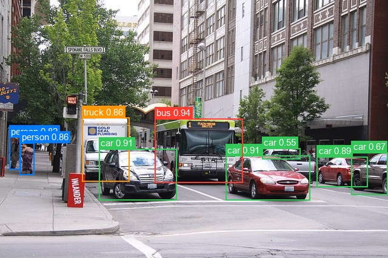
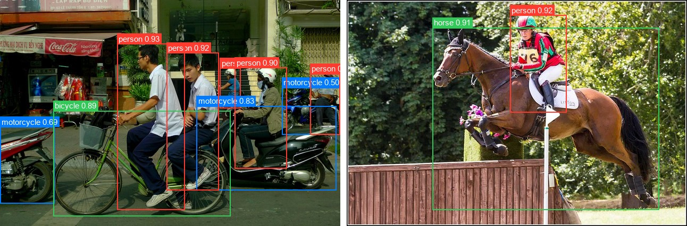

# Deformable DETR

<div class="kf-note kf-note--weights">
<b>Weights:</b> pretrained Keras weights live on Hugging Face under
<a href="https://huggingface.co/zeromodels">zeromodels/&lt;variant&gt;</a>
(each repo carries <code>zm_config.json</code> + <code>model.weights.h5</code>).
Load with <code>from_weights("zeromodels/&lt;variant&gt;")</code>.
</div>

Deformable DETR fixes DETR's two weak spots, slow convergence and poor small-object accuracy, by replacing dense attention with **multi-scale deformable attention**. Every query attends to only a handful of points (4 per head per level), sampled at learned offsets around a reference point and mixed with learned weights. That makes attention cost linear in the number of pixels, so the encoder can afford a feature pyramid: the ResNet stride-8, 16 and 32 stages plus an extra stride-64 level, all projected to 256 channels.

The decoder refines 300 object queries, each attending around its own reference point. Two optional upgrades ship as separate checkpoints: **iterative box refinement**, where every decoder layer refines the boxes of the previous one with its own box head, and **two-stage**, where the encoder output itself proposes regions and the top 300 initialize the decoder queries. The model reaches better accuracy than DETR (especially on small objects) with about 10x fewer training epochs.

**Paper**: [Deformable DETR: Deformable Transformers for End-to-End Object Detection](https://arxiv.org/abs/2010.04159)

## API

### DeformableDETRDetect

```python
DeformableDETRDetect(
    backbone_variant="ResNet50",
    d_model=256,
    encoder_layers=6,
    decoder_layers=6,
    encoder_ffn_dim=1024,
    decoder_ffn_dim=1024,
    encoder_attention_heads=8,
    decoder_attention_heads=8,
    num_feature_levels=4,
    encoder_n_points=4,
    decoder_n_points=4,
    num_queries=300,
    with_box_refine=False,
    two_stage=False,
    dropout_rate=0.1,
    num_classes=91,
    image_size=None,
    input_tensor=None,
    name="DeformableDETRDetect",
)
```

The detection model: backbone, deformable transformer, and the class and box heads.
**This is the class for object detection**, for every variant below: the repo's
`zm_config.json` sets `num_feature_levels`, `with_box_refine` and `two_stage`.

**Parameters**

- **backbone_variant** (`str`, *optional*, defaults to `"ResNet50"`): CNN backbone, `"ResNet50"` or `"ResNet101"`.
- **d_model** (`int`, *optional*, defaults to `256`): transformer width.
- **encoder_layers** (`int`, *optional*, defaults to `6`): encoder depth.
- **decoder_layers** (`int`, *optional*, defaults to `6`): decoder depth.
- **encoder_ffn_dim** (`int`, *optional*, defaults to `1024`): encoder FFN inner dimension.
- **decoder_ffn_dim** (`int`, *optional*, defaults to `1024`): decoder FFN inner dimension.
- **encoder_attention_heads** (`int`, *optional*, defaults to `8`): encoder attention heads.
- **decoder_attention_heads** (`int`, *optional*, defaults to `8`): decoder attention heads.
- **num_feature_levels** (`int`, *optional*, defaults to `4`): `4` for the multi-scale pyramid, `1` for the stride-32 map only.
- **encoder_n_points** (`int`, *optional*, defaults to `4`): encoder sampling points per head per level.
- **decoder_n_points** (`int`, *optional*, defaults to `4`): decoder sampling points per head per level.
- **num_queries** (`int`, *optional*, defaults to `300`): object queries, the hard ceiling on detections per image (two-stage: the proposals kept).
- **with_box_refine** (`bool`, *optional*, defaults to `False`): iterative box refinement, one box head per decoder layer.
- **two_stage** (`bool`, *optional*, defaults to `False`): encoder proposals initialize the queries. Requires `with_box_refine`.
- **dropout_rate** (`float`, *optional*, defaults to `0.1`): dropout, active only during training.
- **num_classes** (`int`, *optional*, defaults to `91`): COCO's 91 classes. Scores are per-class sigmoids, so there is no "no object" class.
- **image_size** (`int` or `tuple`, *optional*, defaults to `None`): `None` builds a dynamic input that takes the processor's aspect-preserving resize. An int or `(H, W)` fixes the input size.
- **input_tensor** (*optional*): pre-existing input tensor to build on.
- **name** (`str`, *optional*, defaults to `"DeformableDETRDetect"`): model name.

**Call** `model(pixel_values, training=False)`. **Returns** a `dict`:

- **logits** (`(B, num_queries, num_classes)`): per-query class logits (apply a sigmoid for scores).
- **pred_boxes** (`(B, num_queries, 4)`): normalized `(cx, cy, w, h)` in `[0, 1]`.
- **last_hidden_state** (`(B, num_queries, d_model)`): decoder output.

Raw output is one prediction per query, most of them low-scoring. Run it through
`post_process_object_detection` to get scored, pixel-space boxes.

### DeformableDetrModel

```python
DeformableDetrModel(
    backbone_variant="ResNet50",
    d_model=256,
    encoder_layers=6,
    decoder_layers=6,
    encoder_ffn_dim=1024,
    decoder_ffn_dim=1024,
    encoder_attention_heads=8,
    decoder_attention_heads=8,
    num_feature_levels=4,
    encoder_n_points=4,
    decoder_n_points=4,
    num_queries=300,
    with_box_refine=False,
    two_stage=False,
    dropout_rate=0.1,
    image_size=None,
    input_tensor=None,
    name="DeformableDetrModel",
)
```

The backbone and deformable transformer without detection heads, ending at the decoder
hidden states. Use it when you want Deformable DETR features to attach your own head
to. It loads from the same repos as the detector.

**Parameters** are identical to [DeformableDETRDetect](#deformabledetrdetect), minus
**num_classes**, and **name** defaults to `"DeformableDetrModel"`.

**Returns** a `dict`:

- **last_hidden_state** (`(B, num_queries, d_model)`): the decoder's last hidden state.
- **intermediate_hidden_states** (`(B, decoder_layers, num_queries, d_model)`): every decoder layer's output.

## Preprocessing

### DeformableDETRImageProcessor

```python
DeformableDETRImageProcessor(
    size=None,
    resample="bilinear",
    do_rescale=True,
    rescale_factor=1 / 255,
    do_normalize=True,
    image_mean=None,
    image_std=None,
    return_tensor=True,
    data_format=None,
)
```

Resizes keeping the aspect ratio, rescales to `[0, 1]`, and normalizes with ImageNet
statistics.

**Parameters**

- **size** (`dict`, *optional*, defaults to `{"shortest_edge": 800, "longest_edge": 1333}`): the short side is resized to `shortest_edge` unless that pushes the long side past `longest_edge`. A `{"height": H, "width": W}` dict resizes to exactly that size instead.
- **resample** (`str`, *optional*, defaults to `"bilinear"`): resize interpolation.
- **do_rescale** (`bool`, *optional*, defaults to `True`): scale pixels to `[0, 1]`.
- **rescale_factor** (`float`, *optional*, defaults to `1/255`): the rescaling factor.
- **do_normalize** (`bool`, *optional*, defaults to `True`): apply mean/std normalization.
- **image_mean** (`tuple`, *optional*, defaults to `(0.485, 0.456, 0.406)`): per-channel mean.
- **image_std** (`tuple`, *optional*, defaults to `(0.229, 0.224, 0.225)`): per-channel std.
- **return_tensor** (`bool`, *optional*, defaults to `True`): return backend tensors rather than numpy.
- **data_format** (`str`, *optional*): `"channels_last"` or `"channels_first"`. Defaults to `keras.config.image_data_format()`.

**Call** `processor(image)` with a path, a PIL image, an array, or a **list** of any
mix of those. **Returns** a `dict`:

- **pixel_values** (`(B, H, W, 3)`): the preprocessed images, in the configured data format.

A list is preprocessed and zero-padded to the largest image in the batch. See
[Batch Processing](#batch-processing-multiple-images).

**post_process_object_detection**

```python
processor.post_process_object_detection(
    outputs, threshold=0.5, target_sizes=None, label_names=None, top_k=100
)
```

Applies a sigmoid to the logits, takes the `top_k` highest scores over every
(query, class) pair, keeps those that clear `threshold`, and converts their boxes to
pixel-space `(x0, y0, x1, y1)` scaled to `target_sizes`.

- **outputs**: the `dict` returned by the model.
- **threshold** (`float`, *optional*, defaults to `0.5`): minimum class score.
- **target_sizes** (`list` of `(height, width)`, *optional*): original image sizes, one per batch element.
- **label_names** (`list` of `str`, *optional*): class names. Defaults to COCO's 91 classes.
- **top_k** (`int`, *optional*, defaults to `100`): candidates kept before thresholding.

**Returns** a list with one `dict` per image:

- **scores**: sigmoid score per kept detection.
- **labels**: integer class indices.
- **label_names**: the resolved class names.
- **boxes**: `(x0, y0, x1, y1)` in pixels.

## Model Variants

Detection variants for `DeformableDETRDetect.from_weights`:

| Variant id                                  | Levels | Box refine | Two-stage | Params  | HF original                                           |
|---------------------------------------------|:------:|:----------:|:---------:|--------:|-------------------------------------------------------|
| `deformable-detr`                           | 4      |            |           | ~40.2 M | `SenseTime/deformable-detr`                           |
| `deformable-detr-single-scale`              | 1      |            |           | ~34.2 M | `SenseTime/deformable-detr-single-scale`              |
| `deformable-detr-with-box-refine`           | 4      | yes        |           | ~41.0 M | `SenseTime/deformable-detr-with-box-refine`           |
| `deformable-detr-with-box-refine-two-stage` | 4      | yes        | yes       | ~41.3 M | `SenseTime/deformable-detr-with-box-refine-two-stage` |

## Basic Usage: Object Detection



```python
from PIL import Image
from zeromodels.models.deformable_detr import (
    DeformableDETRDetect,
    DeformableDETRImageProcessor,
)

repo = "zeromodels/deformable-detr-with-box-refine-two-stage"
model = DeformableDETRDetect.from_weights(repo)
processor = DeformableDETRImageProcessor.from_weights(repo)

image = Image.open("assets/data/coco_city_bus.jpg").convert("RGB")
inputs = processor(image)  # (1, 800, 1199, 3)

output = model(inputs["pixel_values"], training=False)
# output["logits"]:     (1, 300, 91)
# output["pred_boxes"]: (1, 300, 4)

results = processor.post_process_object_detection(
    output, threshold=0.5, target_sizes=[(image.height, image.width)]
)[0]

# Sort by score for readability.
detections = sorted(
    zip(results["scores"], results["label_names"], results["boxes"]),
    key=lambda d: -float(d[0]),
)
for score, name, box in detections:
    print(f"{name:14s} {float(score):.3f}  {[round(float(v)) for v in box]}")
```

```
bus            0.937  [255, 196, 400, 303]
car            0.905  [372, 258, 512, 331]
car            0.905  [163, 246, 291, 332]
car            0.889  [523, 259, 606, 309]
person         0.862  [33, 236, 56, 289]
truck          0.857  [135, 195, 214, 300]
person         0.824  [15, 227, 35, 281]
car            0.669  [580, 252, 640, 322]
car            0.548  [432, 245, 496, 264]
```

Scores are per-class sigmoids rather than a softmax, so `0.5` is a sensible threshold.
The other variants load the same way: change `repo` to any id in
[Model Variants](#model-variants).

### Batch Processing Multiple Images

Pass a list of images and one `target_sizes` entry per image:



```python
from PIL import Image
from zeromodels.models.deformable_detr import (
    DeformableDETRDetect,
    DeformableDETRImageProcessor,
)

repo = "zeromodels/deformable-detr-with-box-refine-two-stage"
model = DeformableDETRDetect.from_weights(repo)
processor = DeformableDETRImageProcessor.from_weights(repo)

paths = ["assets/data/coco_bicycles.jpg", "assets/data/coco_horse_jump.jpg"]
images = [Image.open(p).convert("RGB") for p in paths]

inputs = processor(paths)  # (2, 800, 1199, 3)
output = model(inputs["pixel_values"], training=False)  # (2, 300, 91) and (2, 300, 4)

results = processor.post_process_object_detection(
    output,
    threshold=0.5,
    target_sizes=[(im.height, im.width) for im in images],
)

for path, result in zip(paths, results):
    print(f"\n{path}")
    detections = sorted(
        zip(result["scores"], result["label_names"], result["boxes"]),
        key=lambda d: -float(d[0]),
    )
    for score, name, box in detections:
        print(f"  {name:10s} {float(score):.3f}  {[round(float(v)) for v in box]}")
```

```
assets/data/coco_bicycles.jpg
  person     0.929  [220, 83, 347, 397]
  person     0.918  [313, 100, 411, 359]
  person     0.900  [442, 128, 539, 318]
  bicycle    0.888  [100, 209, 434, 409]
  motorcycle 0.835  [370, 200, 632, 359]
  person     0.820  [583, 139, 640, 254]
  person     0.752  [414, 129, 453, 204]
  motorcycle 0.690  [0, 240, 103, 384]
  motorcycle 0.502  [530, 165, 640, 254]

assets/data/coco_horse_jump.jpg
  person     0.922  [307, 29, 414, 212]
  horse      0.914  [161, 52, 588, 396]
```

Both images here are 640x427, so they resize to the same shape and the batch results
are identical to running the images one at a time. Images of different sizes are
zero-padded to the largest one, and since the model takes no pixel mask, the padded
images' results are a close approximation rather than exact.

## Custom Class Names

A model fine-tuned on your own dataset predicts your class indices, not COCO's. Pass
the names through `label_names` so `label_names` in the result reads correctly:

```python
MY_CLASSES = ["background", "cat", "dog", "bird"]

results = processor.post_process_object_detection(
    output,
    threshold=0.5,
    target_sizes=[(image.height, image.width)],
    label_names=MY_CLASSES,
)
```

Without it the post-processor falls back to the COCO names, which silently mislabels a
custom model. The integer `labels` are unaffected either way.

## Data Format

**Both the models and the processors support `channels_last` and `channels_first`.**
Neither is hard-coded to a layout, so the whole pipeline runs either way.

They pick the format differently, which is the one thing to keep straight:

| | How it picks the format |
|---|---|
| Processors | A `data_format` kwarg, per instance. `None` (the default) resolves to `keras.config.image_data_format()`. |
| Models | Read `keras.config.image_data_format()` when they are **constructed**. There is no `data_format` argument. |

So a processor can be overridden on its own, while a model follows the global setting
in force at build time.

### Overriding the processor only

```python
DeformableDETRImageProcessor(data_format="channels_last")("photo.jpg")
# {"pixel_values": (1, 800, 1066, 3)}   for a 640x480 photo

DeformableDETRImageProcessor(data_format="channels_first")("photo.jpg")
# {"pixel_values": (1, 3, 800, 1066)}
```

### Switching the whole pipeline

Set the global format before constructing the model, and both sides agree:

```python
import keras

keras.config.set_image_data_format("channels_first")

repo = "zeromodels/deformable-detr-with-box-refine-two-stage"
model = DeformableDETRDetect.from_weights(repo)
processor = DeformableDETRImageProcessor.from_weights(repo)

inputs = processor(image)
# inputs["pixel_values"] is (1, 3, 800, 1199)
output = model(inputs["pixel_values"], training=False)
```

Detections are the same under either layout. Only the tensor shape changes.

Note that `keras.config.set_image_data_format` is global state. Set it once at the top
of a script rather than toggling it between calls, since already-built models keep the
layout they were constructed with.

The post-processor is not format-sensitive: it emits `xyxy` pixel boxes and class
indices, which have no channel axis to interpret, so it takes no `data_format` kwarg.

## Loading Fine-tuned and Community Weights

You are not limited to the official variants above. Any Hugging Face repo whose
`model_type` is `"deformable_detr"` loads directly with the `hf:` prefix, including the
original `SenseTime/deformable-detr*` checkpoints and arbitrary user fine-tunes.

```python
from zeromodels.models.deformable_detr import DeformableDETRDetect

# The original SenseTime checkpoints
model = DeformableDETRDetect.from_weights("hf:SenseTime/deformable-detr")

# Somebody's fine-tune
model = DeformableDETRDetect.from_weights("hf:<user>/deformable-detr-finetuned")

# Architecture only, randomly initialized
model = DeformableDETRDetect.from_weights(
    "zeromodels/deformable-detr", load_weights=False
)
```

No shape arguments are needed. The architecture is read from the repo's `config.json`
and mapped onto the constructor: `d_model`, the encoder and decoder depths, heads, FFN
widths and sampling points, `num_feature_levels`, `with_box_refine`, `two_stage`,
`num_queries`, and the backbone. DC5 checkpoints
(`SenseTime/deformable-detr-single-scale-dc5`, a dilated last backbone stage) are not
supported.

Both model classes accept `hf:`, as does `DeformableDETRImageProcessor`, so you can
pull the matching preprocessing from the same repo:

```python
processor = DeformableDETRImageProcessor.from_weights("hf:SenseTime/deformable-detr")
```

Loading `hf:SenseTime/deformable-detr` and the `zeromodels/deformable-detr` Hub variant
produces identical outputs, since they are the same checkpoint by two routes.
